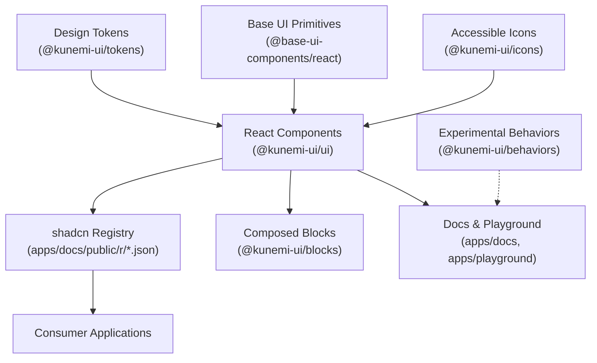

# Kunemi UI

<div align="center">

**Accessible, Extensible, and AI-Native React Design System**

Built on **Base UI** primitives, styled with **Tailwind CSS v4** and semantic CSS variables, and distributed via a **shadcn-compatible registry**.

[](https://www.typescriptlang.org/)
[](https://base-ui.com/)
[](https://tailwindcss.com/)
[](https://www.w3.org/WAI/standards-guidelines/wcag/)
[](https://vitest.dev/)

[Documentation](https://kunemi-ui.dev) · [Interactive Playground](https://kunemi-ui.dev/playground) · [Component Registry](https://kunemi-ui.dev/r/index.json) · [Agent Guide](AGENTS.md)

</div>

---

## Architecture Overview

Kunemi UI bridges accessible headless primitives, fluid design tokens, and AI application building blocks into a unified monorepo:



### Core Tenets
1. **Never Bypass Base UI Primitives**: For stable interactive widgets (dialog, select, tooltip, etc.), rely on Base UI for focus trapping, keyboard navigation, and ARIA state mechanics.
2. **Semantic CSS Tokens**: Zero hardcoded hex values in component markup. Everything maps cleanly to semantic CSS variable classes (`bg-[var(--background)]`, `text-[var(--foreground)]`, `border-[var(--border)]`).
3. **WCAG 2.2 AA Contrast Certified**: Programmatically tested contrast pairings ensuring $\ge 4.5:1$ for normal text and $\ge 3:1$ for control boundaries across both light and dark themes.
4. **Strict Isolation of Experimental Behaviors**: The `@kunemi-ui/behaviors` package hosts experimental streaming and selection adapters. It is never imported inside `@kunemi-ui/ui`.
5. **AI-Native by Design**: Built-in primitives for agentic interfaces (`PromptInput`, `ToolStatus`, `ApprovalDialog`) alongside machine-readable discovery specifications (`llms.txt`, `AGENTS.md`, and an authoring skill).

---

## Monorepo Structure

```text
kunemi-ui/
├── packages/
│   ├── tokens/            # WCAG 2.2 AA certified CSS variables & contrast engine
│   ├── ui/                # Canonical React component source (P0, P1, AI-native)
│   ├── blocks/            # Composed patterns (AuthCard, MetricCard, AIChatBlock)
│   ├── icons/             # Zero-dependency accessible SVG icon wrappers
│   ├── behaviors/         # Isolated experimental behaviors (selection, stream, tree)
│   ├── registry/          # Automated shadcn manifest generator
│   ├── typescript-config/ # Shared strict tsconfig bases
│   └── eslint-config/     # Unified lint rules
├── apps/
│   ├── docs/              # Next.js App Router showcase & /r/*.json registry host
│   ├── playground/        # Interactive multi-tab testbench for components & behaviors
│   └── storybook/         # Component storybook workspace
├── skills/
│   └── kunemi-ui/         # Antigravity AI authoring skill for automated code gen
├── docs/                  # Architecture Decision Records (ADRs) & specifications
├── AGENTS.md              # Machine-readable instructions for AI coding assistants
└── turbo.json             # Turborepo task pipeline configuration
```

---

## Installation & Registry Distribution

Kunemi UI is distributed primarily as a **shadcn-compatible registry**, allowing developers and coding agents to copy clean, canonical source directly into their projects:

```bash
# Add components directly via registry URL
npx shadcn@latest add https://kunemi-ui.dev/r/button.json
npx shadcn@latest add https://kunemi-ui.dev/r/dialog.json
npx shadcn@latest add https://kunemi-ui.dev/r/select.json
npx shadcn@latest add https://kunemi-ui.dev/r/prompt-input.json
npx shadcn@latest add https://kunemi-ui.dev/r/tool-status.json
npx shadcn@latest add https://kunemi-ui.dev/r/approval-dialog.json
npx shadcn@latest add https://kunemi-ui.dev/r/composed-blocks.json
```

Or view the full registry manifest index:
👉 `https://kunemi-ui.dev/r/index.json`

---

## Quick Start (Monorepo Usage)

### 1. Configure Theme Provider (Next.js App Router)

Wrap your root layout with the zero-flash `ThemeProvider`:

```tsx
// app/layout.tsx
import type { Metadata } from "next";
import { ThemeProvider } from "@kunemi-ui/ui";
import "@kunemi-ui/tokens/theme.css";
import "./globals.css";

export default function RootLayout({ children }: { children: React.ReactNode }) {
  return (
    <html lang="en" suppressHydrationWarning>
      <body className="bg-[var(--background)] text-[var(--foreground)] antialiased">
        <ThemeProvider defaultTheme="system" storageKey="kunemi-theme">
          {children}
        </ThemeProvider>
      </body>
    </html>
  );
}
```

### 2. Using Core UI Components

```tsx
import { Button, Input, Label, Dialog, DialogTrigger, DialogPopup, DialogTitle, DialogDescription, DialogClose } from "@kunemi-ui/ui";

export function Example() {
  return (
    <div className="space-y-4">
      <div>
        <Label htmlFor="email" requiredIndicator>Email Address</Label>
        <Input id="email" type="email" placeholder="you@domain.com" />
      </div>

      <Dialog>
        <DialogTrigger render={<Button>Open Dialog</Button>} />
        <DialogPopup>
          <DialogTitle>Accessible Base UI Dialog</DialogTitle>
          <DialogDescription>
            Focus is automatically trapped, ESC closes, and focus restores on dismiss.
          </DialogDescription>
          <div className="mt-4 flex justify-end">
            <DialogClose render={<Button variant="outline">Close</Button>} />
          </div>
        </DialogPopup>
      </Dialog>
    </div>
  );
}
```

### 3. Using AI-Native Primitives

```tsx
import { PromptInput, ToolStatus, ApprovalDialog } from "@kunemi-ui/ui";

export function AgentInterface() {
  return (
    <div className="space-y-4 max-w-xl">
      {/* Tool Execution Lifecycle */}
      <ToolStatus
        toolName="VectorDatabaseQuery"
        state="running"
        durationMs={180}
      />

      {/* High-Stakes Action Confirmation */}
      <ApprovalDialog
        title="Deploy to Production"
        actionName="Production Deploy"
        description="This will deploy version 2.4.0 to all live clusters."
        isDestructive={true}
        trigger={<Button variant="destructive">Trigger Deployment</Button>}
        onApprove={() => console.log("Deployment confirmed")}
      />

      {/* Expandable Multiline Prompt Composer */}
      <PromptInput
        placeholder="Instruct agent (Enter to submit, Shift+Enter for newline)..."
        onSubmitPrompt={(prompt) => console.log("Submitted prompt:", prompt)}
      />
    </div>
  );
}
```

---

## Component Suite

| Category | Components | Primitive Provider |
|---|---|---|
| **Form & Input** | `Button`, `Input`, `Label`, `Checkbox`, `Switch` | Base UI / Standard HTML |
| **Overlays & Popups** | `Dialog`, `Select`, `Tooltip`, `Tabs`, `Menu` | Base UI (`@base-ui-components/react`) |
| **Data Display & Layout**| `Card`, `Badge`, `Alert`, `Skeleton`, `Separator`, `Table`, `Pagination`, `Toast` | Kunemi UI semantic tokens |
| **AI-Native Suite** | `PromptInput`, `ToolStatus`, `ApprovalDialog` | Base UI + Accessibility live regions |
| **Composed Blocks** | `AuthCard`, `MetricCard`, `AIChatBlock` | `@kunemi-ui/blocks` |
| **Accessible Icons** | 20+ SVG icons (`Sparkles`, `Bot`, `Loader`, `Send`, `Sun`, `Moon`, etc.) | `@kunemi-ui/icons` |
| **Experimental Behaviors**| `useSelectionModel`, `useStreamResponse`, `useTreeNavigation` | `@kunemi-ui/behaviors` |

---

## AI Agent Integration

Kunemi UI is engineered to be instantly discoverable and operable by autonomous coding agents (Antigravity, Claude Code, Cursor, Codex):

- **[`AGENTS.md`](AGENTS.md)**: Repository rules, constraints, architectural boundaries, and verification mandates.
- **[`skills/kunemi-ui/SKILL.md`](skills/kunemi-ui/SKILL.md)**: Step-by-step authoring skill for creating new Base UI primitives and blocks.
- **[`/llms.txt`](apps/docs/public/llms.txt)** & **[`/llms-full.txt`](apps/docs/public/llms-full.txt)**: Machine-readable documentation endpoints served by the documentation site.

---

## Development & Verification

### Prerequisites
- Node.js $\ge 20$ (Recommended: Node 22)
- `pnpm` $\ge 9$ (Monorepo uses `pnpm@12` with Corepack)

```bash
# Install dependencies
pnpm install

# Start local documentation and playground
pnpm dev

# Execute complete verification suite (required before any commit)
pnpm typecheck   # Typecheck all 11 packages and apps
pnpm lint        # Run ESLint across workspace
pnpm test        # Run 72 unit tests via Vitest
pnpm build       # Compile registry and Next.js applications
```

---

## License

MIT © [Adekunle Adeyemi](https://github.com/adeyemiadekunle)
