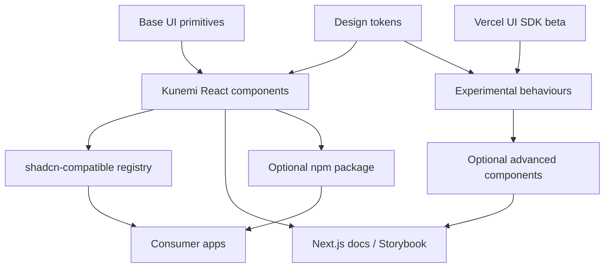

# Kunemi UI — Technical Architecture

## Architectural decision

Use shadcn's Base UI-backed component approach as the stable foundation. Build Kunemi-owned styled components and contracts on top. Use Vercel UI SDK only for separately scoped custom behaviours. Do not let two primitives manage focus, selection or dismissal for the same widget.



## Monorepo

```text
kunemi-ui/
  apps/
    docs/
    playground/
    storybook/
  packages/
    tokens/          # CSS variables and theme mappings
    ui/              # React component source
    behaviors/       # optional experimental SDK adapters
    registry/        # registry manifest and generation scripts
    blocks/          # composed application patterns
    icons/           # optional icon conventions and wrappers
    typescript-config/
    eslint-config/
  skills/kunemi-ui/SKILL.md
  AGENTS.md
  pnpm-workspace.yaml
  turbo.json
  package.json
```

## Stack and boundaries

| Layer | Choice |
|---|---|
| Runtime | React + TypeScript |
| Docs | Next.js App Router + MDX |
| Styling | Tailwind CSS v4, CSS variables, CVA where useful |
| Primitives | Base UI |
| Components | Kunemi-owned source, adapted shadcn patterns |
| Experimental | @ui-sdk/core, @ui-sdk/react |
| Tooling | pnpm, Turborepo, Storybook, Changesets |
| Quality | Vitest, Testing Library, Playwright, axe-core |

Keep `tokens` independent of React; `ui` depends on tokens and primitives; `blocks` depends on `ui`; `behaviors` must not be a dependency of stable `ui`. Registry items should be generated from canonical source, not independently maintained copies.

## Bootstrap (illustrative commands)

```bash
pnpm dlx shadcn@latest init -t next --monorepo
# Choose Base UI if offered; name the workspace kunemi-ui.
# Run add from the configured application workspace.
pnpm dlx shadcn@latest add button input dialog select tabs tooltip
```

Verify CLI options and generated aliases against the installed version. Pin resolved dependencies with the lockfile. Only after creating the experimental workspace, install SDK dependencies there:

```bash
pnpm --filter @kunemi-ui/behaviors add @ui-sdk/core @ui-sdk/react
```

## Public contracts

Use named exports, explicit TypeScript props, semantic token classes, stable component variants and documented controlled/uncontrolled state. Forward supported native props and refs where appropriate. Use client boundaries only for interactivity; keep static content server-compatible where possible. Do not expose SDK internals through stable component APIs.

## CI and validation

Run formatting, lint, typecheck, unit tests, docs and registry builds, browser interaction tests, axe checks and visual regression tests. Validate hydration, focus restoration, escape handling, reduced motion, zoom and both themes. Test clean consumer installs. Record supported React/Next.js and browser versions based on actual test results.

## Decision records

- ADR-001: Base UI over a bespoke stable behaviour engine.
- ADR-002: CSS semantic tokens over per-component hardcoded colours.
- ADR-003: Registry-first distribution; npm optional after validation.
- ADR-004: Beta SDK isolation and explicit opt-in.
